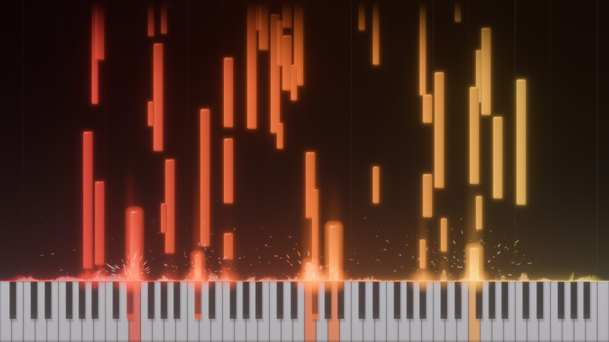
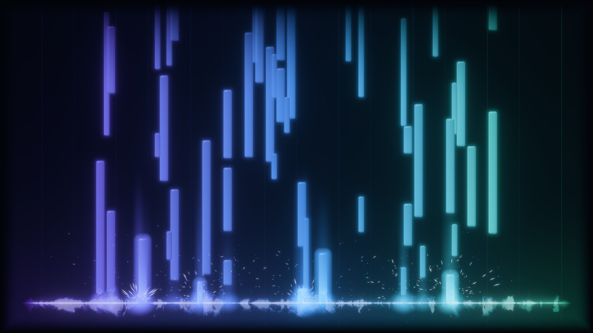
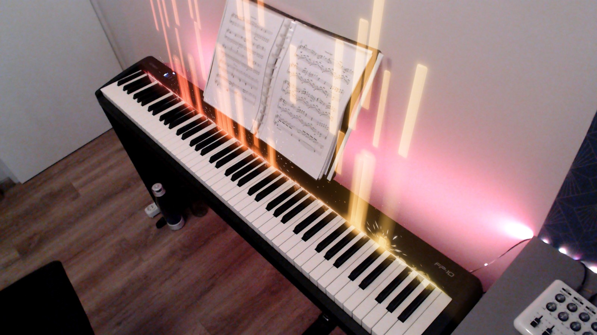
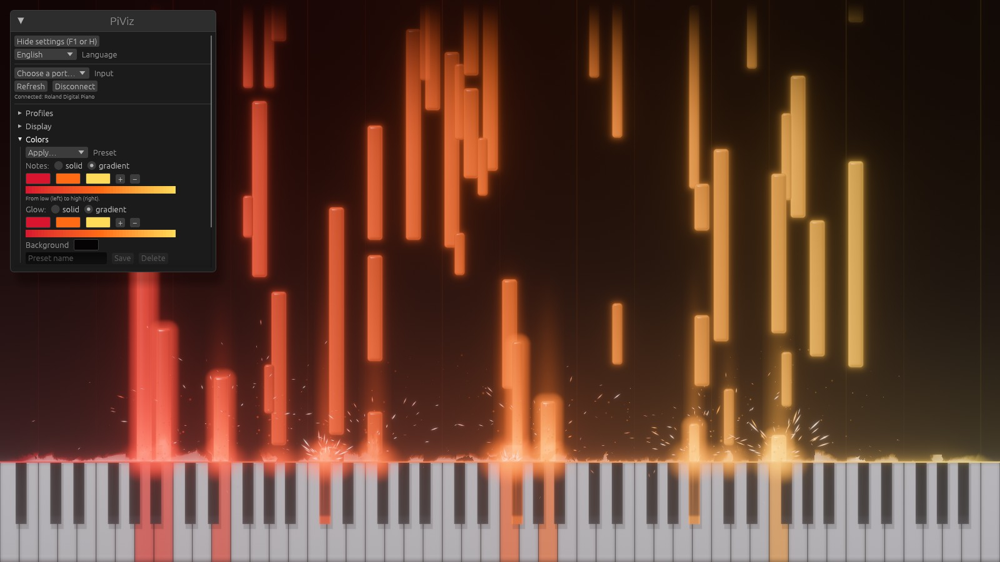

<div align="center">


# PiViz

**A real-time visualizer for your MIDI piano.**

Notes rise from the keyboard as glowing bars over an animated flame line, with sparks, bloom and
SoundFont sound. Made for practice, streaming and video.

[](https://github.com/ayn0s/PiViz/actions/workflows/ci.yml)
[](https://github.com/ayn0s/PiViz/releases/latest)

[Download](https://github.com/ayn0s/PiViz/releases/latest) ·
[Remote control API](docs/API.md)

<br>



</div>

## Features

- **Live MIDI**: connects to your piano automatically and plays it through any SoundFont.
- **Visuals**: beveled glowing notes, animated flames, sparks and embers, bloom.
- **Colors**: solid or gradient notes and glow, built-in presets and your own.
- **Profiles**: save complete looks and switch between them.
- **Camera mode**: a webcam image with the notes rising from your real keyboard, in perspective.
- **Streaming**: black or transparent background for OBS, frame rate limit.
- **Remote control**: a WebSocket API for a Stream Deck plugin or a script.
- English and French interface; Windows and Linux.

## Screenshots

| Without the keyboard, with a gradient preset | Camera mode | The settings panel |
|---|---|---|
|  |  |  |

## Download

Get the latest release from the [releases page](https://github.com/ayn0s/PiViz/releases/latest):

| Platform | File |
|---|---|
| Windows | `PiViz-Setup-vX.Y.Z.exe` installer (no admin rights needed), or a portable `.zip` |
| Linux | `.tar.gz` |

## Getting started

1. **Plug in your piano** and start PiViz: it connects to the instrument used last time, or the
   first one found. Choose another in the settings panel.
2. **Add a sound**: no SoundFont is bundled. Drop any `.sf2` file onto the window once; it is
   remembered.
3. **Tune the look** in the settings panel: display, colors, profiles, camera, audio.

Everything is saved automatically, in `%APPDATA%\piviz\settings.toml` on Windows and
`~/.config/piviz/settings.toml` on Linux.

### Shortcuts

| Key | Action |
|---|---|
| <kbd>F1</kbd> or <kbd>H</kbd> | Show / hide the settings panel |
| <kbd>F11</kbd> | Fullscreen |
| <kbd>Enter</kbd> or <kbd>Esc</kbd> | Finish placing the keyboard (camera mode) |

## Camera mode

Choose the **camera** background, then **Place the keyboard**: drag points 3 and 4 to the ends of
the flame line, on the far edge of your keyboard, and points 1 and 2 a little above them to set
the perspective. A grid shows the result live.

The **Format** list picks the camera's resolution and frame rate. On Windows, **Camera
settings…** opens the driver's own settings (exposure, focus, white balance). If the camera
delivers fewer frames than expected, turn auto exposure off there.

## Streaming with OBS

Hide the settings panel (<kbd>F1</kbd>), then either:

- **Transparent background**: add a *Game Capture* source on PiViz with *Allow Transparency*
  checked. The window itself looks black on the desktop.
- **Black background**: add a *Window Capture* source and set its blend mode to *Screen* or
  *Additive*.

## Remote control

PiViz listens on `ws://127.0.0.1:7341` (this computer only). A Stream Deck plugin or a script can
read the state and change any setting live: colors, presets, profiles, camera, panel…

```json
{ "type": "color_preset", "step": 1 }
```

The protocol is documented in [docs/API.md](docs/API.md).

## Command line

```sh
piviz [--port NAME] [--soundfont FILE.sf2] [--black | --transparent] [--bench]
```

| Option | |
|---|---|
| `--port NAME` | MIDI input whose name contains `NAME` |
| `--soundfont FILE` | SoundFont to load |
| `--black` | Pure black background |
| `--transparent` | Transparent background (alpha channel, for capture) |
| `--bench` | Simulated playing without vsync, fps printed to the console |

PiViz also looks for a SoundFont named `default.sf2` in `%APPDATA%\piviz\` (Windows),
`~/.local/share/piviz/` (Linux), the working directory and the executable's directory, or at the
path in `PIVIZ_SOUNDFONT`.

## Building from source

Requires Rust 1.95 or later, and:

- **Windows**: Visual Studio Build Tools (C++ workload)
- **Linux**: `pkg-config`, a Vulkan driver, libclang, and the ALSA, udev, X11 and Wayland headers
  (Debian/Ubuntu: `libasound2-dev libudev-dev libx11-dev libxkbcommon-dev libwayland-dev libclang-dev`)

```sh
cargo run --release
```

### Documentation

- `cargo docs --open`: HTML reference of every module, type and function, from the comments
  in the code.
- Translations live in `locales/<code>.json`.

### Releasing

Bump `version` in `Cargo.toml`, run `cargo build` to update `Cargo.lock`, commit, then push a
matching tag:

```sh
git tag v0.6.2
git push origin main v0.6.2
```

The release workflow builds the Windows installer and the archives, and publishes them.

## License

Licensed under either of [MIT](LICENSE-MIT) or [Apache-2.0](LICENSE-APACHE), at your option.
